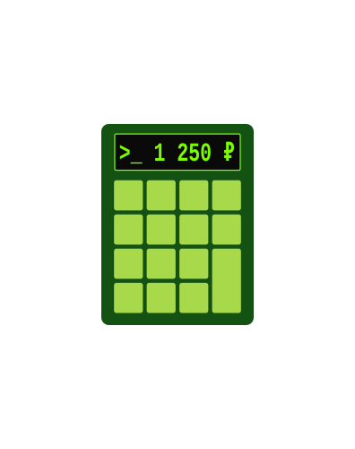

  

<h1 align="center">asledger</h1>

<b>Программный комплекс для ведения домашней бухгалтерии</b>

---

> 🚧 **Проект находится в активной разработке.**
> Этот README — временная заглушка. Полное описание, установка и документация
> появятся ближе к релизу `v1.0.0`. Требования и план работ ведутся в
> [эпике #1](https://github.com/trefas/asledger/issues/1).

## О проекте

**asledger** — комплекс для домашней бухгалтерии со строгой двойной записью по
иерархическому плану счетов. Учёт ведётся только в рублях (₽), наименования
счетов и интерфейс — на кириллице.

Комплекс включает:

- **сервер** — демон-служба (systemd на Linux): web-интерфейс на порту **8777**,
  REST API на порту **8778**, хранение — SQLite в режиме WAL;
- **web-интерфейс** — ввод проводок с бухгалтерским «помощником», настройка плана
  счетов, отчёты, импорт/экспорт;
- **мобильное приложение Android** (отдельный эпик) — офлайн-клиент с локальной
  репликой и синхронизацией.

## Цели

- Строгая двойная запись (Σ DEBIT = Σ CREDIT в каждой транзакции) без потери
  сходимости баланса.
- Синхронизация по модели «синхронизация = коммит»: сервер — единственная точка
  порядка операций, устройство — локальная ветка с офлайн-работой.
- Понятный ввод проводок: подсказки счетов, предупреждения о неверном типе
  счёта, диалог частичной оплаты.
- Свободная миграция данных: импорт планов счетов из JSON и шаблонов, импорт
  старых книг **hledger (plaintext)**, экспорт в CSV / hledger / JSON.
- Работа в домашней сети нескольких пользователей (членов семьи) без потери
  целостности баланса.

## Задачи

Разработка ведётся по спринтам (вехам) от инфраструктуры до релиза.
Полная декомпозиция — в [эпике #1](https://github.com/trefas/asledger/issues/1).

| Веха | Результат |
|---|---|
| [S0 — Инфраструктура](https://github.com/trefas/asledger/milestone/1) | monorepo собирается, CI-каркас, тест-фреймворк, конфигурация |
| [S1 — Слой данных](https://github.com/trefas/asledger/milestone/2) | схема SQLite, миграции, CRUD, инвариант баланса, правила дерева, импорт плана счетов |
| [S2 — Движок и матрица](https://github.com/trefas/asledger/milestone/3) | матрица ASL-2.2 на 8 типов, MVP-операции, тест на каждую ячейку |
| [S3 — REST API](https://github.com/trefas/asledger/milestone/4) | pair/snapshot/push/pull, идемпотентность, rebase, коды ответов, suggest |
| [S4 — Web-каркас и ввод](https://github.com/trefas/asledger/milestone/5) | ввод с помощником, частичная оплата, план счетов, пользователи |
| [S5 — hledger](https://github.com/trefas/asledger/milestone/6) | парсер, режимы строгий/гибкий, идемпотентность, экспорт (round-trip) |
| [S6 — Отчёты и сверка](https://github.com/trefas/asledger/milestone/7) | отчёты по дереву и по актёрам, сверка счёта, дедупликация |
| [S7 — Интеграционные тесты](https://github.com/trefas/asledger/milestone/8) | параллельные клиенты, конфликты, хэш-цепочка, ресинк |
| [S8 — Release](https://github.com/trefas/asledger/milestone/9) | артефакты Linux/Windows, systemd-юнит, документация |

Критический путь: `S0 → S1 → S2 → S3 → S4 → S5 → S6`; `S7` и `S8` частично
идут параллельно с `S6`.

## Статус

- [x] S0 — Инфраструктура
- [x] S1 — Слой данных
- [x] S2 — Движок и матрица
- [x] S3 — REST API
- [x] S4 — Web-каркас и ввод
- [x] S5 — hledger
- [x] S6 — Отчёты и сверка
- [x] S7 — Интеграционные тесты
- [ ] S8 — Release

## Вне рамок первой версии

Мультивалютность и курсы, бюджеты и лимиты, облачный хостинг, шифрование
хранилища, роли помимо персональной аутентификации, пакеты `.deb`/`.rpm`,
macOS и автообновления.

## Лицензия

[MIT](LICENSE) © 2026 Andrey Semenow
