# Android-приложение asledger

Мобильный клиент для Android — отдельный эпик
[#90](https://github.com/trefas/asledger/issues/90). Документ фиксирует
архитектуру, протокол и границы первой версии. API и протокол синхронизации
остаются совместимыми; изменения сервера аддитивны для Android.

## Совместимость

- **Android 12 (API 31) и новее.**
- Язык — Kotlin, интерфейс — Jetpack Compose (Material 3).
- Учёт только в рублях (₽), интерфейс на кириллице.
- Ориентация — портретная и альбомная; телефон и планшет.

## Совместимость с зашифрованным сервером

С `v1.3.0` книга на сервере шифруется SQLCipher, но Android-клиент не меняет
API, формат снапшота и авторизацию. Пароль книги вводится при запуске
`asledgerd` или в desktop-клиенте; Android получает токен устройства и не
хранит пароль. JVM-интеграционный тест
`AndroidServerIntegrationTest` запускает настоящий `asledgerd` с
`-password-file`, поэтому проверяет синхронизацию с зашифрованной книгой.

## Первый запуск

На первом экране **только два поля**:

| Поле | Значение по умолчанию |
| --- | --- |
| Адрес сервера | — (IP или имя в домашней сети) |
| Порт API | `8778` |

Порт можно изменить, если сервер запущен с другим `-api-addr`. Логин и пароль
книги не запрашиваются: сервер уже открыл зашифрованную книгу, а приложение
привязывается к пользователю через токен.

Порядок первого запуска:

1. Приложение нормализует адрес (убирает схему, путь и порт из поля хоста) и
   проверяет `GET /api/v1/health`.
2. Сверяет `format_version` из ответа с поддерживаемой версией снапшота. При
   несовместимости показывает «Обновите asledgerd» и не сохраняет адрес.
3. Сохраняет адрес, версию сервера и постоянный `client_id` устройства в
   DataStore, затем вызывает `POST /api/v1/auth/enroll`.
4. Если в книге несколько пользователей, показывает список имён и повторяет
   `enroll` с выбранным `user_id`.
5. Шифрует токен ключом Android Keystore и сохраняет только шифротекст.
   Открытый токен не пишется в журнал и не показывается в интерфейсе.

Ошибки различаются по классам: неизвестный хост, отказ соединения, таймаут,
HTTP 4xx/5xx, чужой сервис по адресу и несовместимый формат. Для каждого
класса на экране есть отдельное объяснение и подсказка; кнопка после ошибки —
«Проверить ещё раз». Последний сохранённый адрес подставляется при повторном
открытии экрана.

## Возможности первой версии

- Просмотр загруженного плана счетов: дерево, типы, поиск, архив, остатки и
  обороты; частые счета поднимаются в начало выбора.
- Журнал проводок с комбинируемыми фильтрами, поиском, статусом синхронизации,
  деталями, сторно подтверждённой проводки и повтором.
- Создание и редактирование проводки офлайн: несколько строк **в дебете и
  кредите**, роли ASL-2.2 с сервера, проверка типа счёта и баланса, быстрые
  суммы.
- Очередь отправки: локально сохранённые проводки уходят на сервер по кнопке
  или автоматически при старте, возврате в приложение и сохранении.
  Отклонённая проводка сохраняется для исправления.
- Загрузка изменений сервера: дельта через `pull`, полный ресинк при
  расхождении; очередь и `android.*` настройки при этом не теряются.
- Онбординг-тур, справка, пустые и офлайн-состояния, понятные ошибки, дубли и
  предупреждения rebase.

## Строки и локализация

Интерфейс приложения — только на русском языке. Все пользовательские тексты
находятся в `app/src/main/res/values/strings.xml`; в Compose и слое данных нет
русских литералов. Слой данных не зависит от `Context`: вместо готовых строк он
возвращает `@StringRes`-идентификаторы, а UI разрешает их через `stringResource`.

- Ошибки подключения описаны типами `ConnectionError` → `ConnectionProblem` с
  `titleRes` и `ConnectionDetail` (`Resource` с аргументами или `Text` для
  динамического ответа сервера). Разрешение текста — в
  `ui/components/ConnectionProblemUi.kt`.
- Названия типов счетов и статусов синхронизации в моделях хранятся как
  `titleRes`, а не как строки.
- Даты для списка возвращают `FriendlyDate` (`Today`, `Yesterday`,
  `Absolute`); подписи «сегодня» и «вчера» выбираются в Compose из ресурсов.
  Обычные даты и время форматируются как `дд.мм.гггг` и
  `дд.мм.гггг ЧЧ:мм`.
- Денежные суммы по-прежнему считаются в копейках (`Long`) и форматируются
  общим `formatKop`: `12 345,67 ₽`, без `Float`/`Double`.
- Значения протокола `трата`, `доход` и `перевод` остаются серверными ключами
  и ключами локальной базы; для показа используется `operationTypeLabel()` с
  ресурсными подписями.
- Технические исключения и логи не являются пользовательским текстом и
  остаются на английском, чтобы их было проще искать в отчётах.

## Архитектура клиента

```
ui/ (Compose) ── AppContainer ── data/repository ── Room (локальная реплика)
      │                              ├─ data/network (Ktor) ── HTTP :8778 ── asledgerd
      │                              ├─ data/settings (DataStore)
      │                              └─ data/security (Keystore)
      └─ sync/ (outbox, push/pull, хэш-цепочка, WorkManager)
```

- **UI** — Compose + Navigation; состояние экранов локальное, зависимости
  передаются из `AppContainer`, без глобальных mutable-синглтонов.
- **Ktor Client (OkHttp) + kotlinx.serialization** — REST API; таймауты и
  повторные попытки заданы в одном месте. Повторяются только сетевые ошибки и
  5xx: записывающие операции идемпотентны по `client_id`/`uuid`.
- **DataStore** — адрес, порт, `client_id`, выбранный пользователь, версия
  сервера, формат снапшота и время последней синхронизации.
- **Android Keystore** — ключ AES/GCM; в DataStore лежит только шифротекст
  токена. При `401` сессия очищается, приложение возвращается к привязке;
  локальные черновики при этом не удаляются.
- **Room** — локальная реплика: счета, проводки и строки, пользователи,
  настройки, метаданные (`head_seq`, `chain_hash`, `localCounter`), outbox и
  коммиты. Схема версионируется, миграции экспортируются в `android/app/schemas`.
- **WorkManager** — фоновая отправка: только при подключённой сети, период не
  чаще 15 минут, экспоненциальный backoff от 30 секунд и не более 8 запусков
  подряд для временных сетевых ошибок.
- **Репозитории** отдают `Flow` из Room; расчёт остатков и оборотов выполняется
  локально без обращения к серверу.

## Серверные дополнения

Все изменения обратно совместимы: существующие клиенты и web продолжают
работать, версия API остаётся `/api/v1`.

### Привязка устройства

`POST /api/v1/auth/enroll`

```json
{ "client_id": "android-…", "device_name": "Телефон" }
```

- один пользователь в книге → `200` с токеном;
- несколько пользователей → `409 ERR_ENROLL_USER_REQUIRED` и список
  `users: [{id, name}]`; повторный запрос с `user_id` выдаёт токен;
- привязка разрешена только из локальной сети;
- настройка книги `привязка_устройств = allow|deny`; отзыв — на странице
  «Устройства» в web-интерфейсе и через `DELETE /api/v1/auth/token`.

### Роли и стороны матрицы

`GET /api/v1/engine/roles?op_type=трата` возвращает роли, сторону
(`DEBIT`/`CREDIT`), допустимые типы счетов, признаки `direction_required` и
`reserved`. Клиент строит секции «Дебет» и «Кредит» по этому ответу, поэтому
матрица ASL-2.2 не дублируется в Kotlin.

## Синхронизация

1. **Первичная загрузка** — `GET /sync/snapshot`: счета, пользователи,
   настройки, проводки, `head_seq`, `chain_hash`; импорт в Room одной
   транзакцией. Пустые массивы Go (`null` в JSON) читаются как пустые списки.
2. **Локальная проводка** — сохраняется в Room и в outbox со статусом
   `pending`, `commit_id = <client_id>:<номер>`, `base_seq` — последний
   известный `head_seq`. Все pending-проводки отправляются одним пакетом с
   общим `commit_id`; счётчик хранится в `sync_meta` и переживает перезапуск.
3. **Отправка** — `POST /sync/push`. Ответы `accepted`,
   `accepted-with-warnings`, `rejected` и `duplicates` отображаются
   пользователю. Повтор после обрыва использует тот же `commit_id`, поэтому
   сервер не создаёт дубль. Статусы outbox: `draft`, `pending`, `sending`,
   `synced`, `rejected`.
4. **Загрузка** — `GET /sync/pull?since=…&hash=…`; при `resync_required` или
   расхождении хеша загружается полный снапшот, очередь, отклонённые проводки
   и локальные `android.*` настройки сохраняются.
5. **Хэш-цепочка** — клиент вычисляет `SHA-256(prev_hash || ops_json)` по
   точным строкам `ops_json` из ответа `pull`, без повторной сериализации
   JSON. Расхождение — сигнал полного ресинка.

Конфликты решаются порядком коммитов на сервере (master), как в git:
отставший `base_seq` получает предупреждение rebase, а не перезаписывает
чужие данные.

## Модель безопасности

Привязка без пароля — осознанный компромисс для домашней сети:

- сервер слушает локальную сеть, порты не публикуются в интернет;
- привязка с публичного IP отклоняется;
- новые привязки можно запретить настройкой, устройства видны в web и
  отзываются одним действием;
- токен устройства хранится в Keystore и не логируется;
- HTTPS и VPN остаются за рамками: транспорт рассчитан на доверенную сеть.

## Экраны

| Экран | Назначение |
| --- | --- |
| Подключение | адрес сервера и порт, проверка `/health`, понятные ошибки |
| Привязка | enroll без пароля, выбор пользователя, сохранение токена |
| Диагностика | адрес, версия и формат сервера, пользователь, последняя синхронизация; токен скрыт |
| Онбординг | 4 шага тура, пропуск и повтор из справки |
| Журнал | проводки, фильтры, статусы, пустые состояния, обновление жестом вниз |
| Проводка | тип, дата, описание, роли, строки дебета и кредита, баланс, быстрые суммы; счета фильтруются по типу роли |
| Детали | строки, автор, дата, статус, сторно подтверждённой проводки, повтор |
| План счетов | дерево, типы, поиск, архив, остатки и обороты |
| Синхронизация | очередь, предупреждения, дубли, отклонённые операции, исправление |
| Справка | онбординг, подсказки по работе с книгой |
| Настройки | сервер, пользователь, диагностика, повтор тура, «О приложении» |

## Оформление

- Логотип — из `assets/logo/asledger-logo.svg`, adaptive icon на его основе.
- Палитра как у web: `#145214` (primary), `#2f7a2f`, `#f7f8f5` (фон),
  `#a4261d` (ошибка).
- Шрифты — системные (Roboto/system-ui), как в web-интерфейсе.
- Тёмная тема — с сохранением фирменных зелёных акцентов.

## Сборка и проверки

Требуются JDK 21 и Android SDK с платформами `android-35`/`android-36` и
build-tools `35.0.0`/`36.0.0` (`minSdk 31`, `compileSdk` 35, `targetSdk` 34).

```bash
cd android
./gradlew :app:assembleDebug        # debug APK
./gradlew :app:testDebugUnitTest    # unit- и Robolectric-тесты
./gradlew :app:verifyDataCoverage   # порог 70 % строк слоя data
./gradlew :app:lintDebug            # линт
./gradlew :app:ktlintCheck          # стиль Kotlin
./gradlew :app:assembleRelease      # подписанный APK (нужен keystore)
```

Из корня репозитория: `make android-check` (сборка, unit-тесты, lint и ktlint) или
`make android-debug` (только debug APK). Debug APK собирается в CI на каждый
push.

### Интеграционные тесты

`AndroidServerIntegrationTest` поднимает настоящий `asledgerd` на случайных
портах поверх временной книги и проходит сценарии:

- enroll двух клиентов → snapshot → офлайн-проводка → push → pull вторым
  клиентом;
- отставший `base_seq` и предупреждение rebase;
- отклонённая сервером проводка и её сохранение при полном resync.

Тест использует только localhost и пропускается, если нет `ASLEDGERD_BIN`.
В CI сервер собирается командой `make build` перед запуском Gradle.

### Подпись release APK

Ключ хранится вне репозитория. В CI используются секреты GitHub Actions:

| Секрет | Назначение |
| --- | --- |
| `ANDROID_KEYSTORE_BASE64` | keystore в base64 |
| `ANDROID_KEYSTORE_PASSWORD` | пароль хранилища |
| `ANDROID_KEY_ALIAS` | alias ключа |
| `ANDROID_KEY_PASSWORD` | пароль ключа |

Локально те же значения читаются из `android/keystore.properties` (в
`.gitignore`) или переменных `ANDROID_KEYSTORE_PATH`,
`ANDROID_KEYSTORE_PASSWORD`, `ANDROID_KEY_ALIAS`, `ANDROID_KEY_PASSWORD`.
Без ключа `assembleRelease` собирается с debug-подписью и предупреждением: такой
APK годится только для проверки R8 и не публикуется.

`versionName` берётся из тега без `v`, `versionCode` — по схеме
`major*10000 + minor*100 + patch` (`v1.3.3` → `1.3.3` / `10303`). Workflow
проверяет подпись, `versionName`, `versionCode` и `minSdk` через `apksigner` и
`aapt`, затем публикует `asledger-<версия>.apk` и
`asledger-<версия>.apk.sha256`.

Создание нового ключа (однократно, с резервной копией):

```bash
keytool -genkeypair -keystore asledger-release.jks -alias asledger \
  -keyalg RSA -keysize 4096 -validity 10000
base64 -w0 asledger-release.jks   # значение для ANDROID_KEYSTORE_BASE64
```

## Вехи

| Веха | Задачи | Содержание |
| --- | --- | --- |
| S9 — каркас и бренд | #91–#95 | Gradle/Compose, тема и лого, навигация, CI |
| S10 — подключение | #96–#102 | enroll, экран адреса и порта, токен, выбор пользователя |
| S11 — локальная реплика | #103–#108 | Room, импорт снапшота, репозитории, остатки |
| S12 — синхронизация | #109–#115 | outbox, push/pull, хэш, конфликты, автосинк |
| S13 — счета и ввод | #116–#123 | дерево, форма дебета/кредита, валидация, журнал |
| S14 — онбординг и UX | #124–#127 | тур, состояния, подсказки, доступность |
| S15 — релиз APK | #129–#133 | подпись, R8, APK в релизе, SHA-256, документация |
| S16 — локализация | #128 | все пользовательские строки в `res/values/strings.xml`, ресурсные ошибки слоя данных |

Функциональные вехи S9–S15 закрыты. Релизный APK `1.0.0` (versionCode `10000`)
собран с `minSdk 34`, подписан стабильным ключом, проверен `apksigner` и
приложен к GitHub Release вместе с SHA-256. Сборка `1.0.1` (versionCode `10001`)
добавила фильтрацию счетов по роли, обновление журнала жестом, переход к дублю
и адаптацию интерфейса к крупному шрифту. Сборка `1.0.2` (versionCode `10002`)
исправила контраст третичного акцента в светлой теме и добавила автоматические
проверки WCAG AA и восстановления состояния формы.

Сборка `1.0.3` (versionCode `10003`) добавляет подсказки у типа операции,
дебета/кредита, роли и остатка к распределению. Первое открытие журнала, формы и
экрана синхронизации сопровождается коротким объяснением; факт просмотра
запоминается в отдельном SharedPreferences и не показывается повторно. Подсказки
закрываются кнопкой «Понятно» или нажатием вне окна и не блокируют ввод. Раздел
«Справка» дополнен темами о дебете, кредите и ролях.

Релиз `v1.0.3` опубликован workflow
[39786725105](https://github.com/trefas/asledger/actions/runs/39786725105).
APK `asledger-1.0.3.apk` имеет SHA-256
`e17c40b79ebf3ff7ff1c85cd9026fe78671d1a71a2c2c8d06fb87588241f6ae2`;
после скачивания проверка `sha256sum -c` и установка поверх `1.0.2` выполнены
успешно, данные приложения сохранились. На смартфоне пользователя этот APK
показал «При анализе пакета произошла ошибка»; диагностика ведётся в
[#135](https://github.com/trefas/asledger/issues/135).

Сборка `1.0.4` (versionCode `10004`) добавляет к release APK v3-подпись
поверх v2: часть установщиков отклоняет APK только с v2-схемой. Workflow
проверяет обе схемы через `apksigner --min-sdk-version 24`, а также
`versionName`, `versionCode`, `minSdk` и целостность APK. Сборка проверена
`zipalign` (4 КБ и 16 КБ) и установлена через `adb` на эмулятор Android 14
(API 34) поверх `1.0.3` с сохранением данных.

Релиз `v1.0.4` опубликован workflow
[39794526068](https://github.com/trefas/asledger/actions/runs/39794526068).
APK `asledger-1.0.4.apk` имеет размер `4 561 412` байт и SHA-256
`756cf995583e64cb9aa6925dcce3d253a54a8c03449cc9538b96ccc2d61fd809`.
Скачанный из релиза файл проверен `sha256sum -c`, `apksigner` (v2 и v3),
`zipalign` (4 КБ и 16 КБ) и установлен на API 34.

Сборка `1.0.5` (versionCode `10005`) делает точку входа лаунчера явной:
у `application` и `MainActivity` указан `android:enabled="true"`, у
`MainActivity` — `android:icon`. Категория `LAUNCHER` была в манифесте и
раньше: `aapt dump badging` для `1.0.4` уже показывал
`launchable-activity: com.trefas.asledger.MainActivity`. Релиз
`v1.0.5` опубликован workflow
[39803143482](https://github.com/trefas/asledger/actions/runs/39803143482);
APK `asledger-1.0.5.apk` имеет размер `4 561 412` байт и SHA-256
`0dd8e4159e937facc7acafc7e27620c55c76b2f24510f9c2d583383c4d38f1c9`.

Сборка `1.0.6` (versionCode `10006`) снижает `targetSdk` с 36 до 34.
Фактическая причина ошибки установки на Huawei nova 14i (Android 12, API 31)
оказалась в `minSdk 34`: `adb install` возвращал
`INSTALL_FAILED_OLDER_SDK: Requires newer sdk version #34 (current version is #31)`.
`targetSdk` остаётся 34, `compileSdk` — 36. Релиз опубликован workflow
[39812643245](https://github.com/trefas/asledger/actions/runs/39812643245);
APK `asledger-1.0.6.apk` имеет размер `4 561 412` байт и SHA-256
`e59adaec195fe72b57c33dd450676d9d8d819c4ead36b75a28c41edc31c780e7`.

Сборка `1.0.7` (versionCode `10007`) снижает `compileSdk` с 36 до 35 —
минимума, который требуют Compose 1.8 и AndroidX 1.16. Собрать с
`compileSdk 34` нельзя: зависимости явно требуют 35. `targetSdk` остаётся
34, `minSdk` — 34. Релиз опубликован workflow
[39824026596](https://github.com/trefas/asledger/actions/runs/39824026596);
APK `asledger-1.0.7.apk` имеет размер `4 561 412` байт и SHA-256
`4f1221e4c6b1c2bf27091888f7fa299f3632dd7069a124f9b68c6b62e01be6d3`.
В Compose нет `res/layout`: UI компилируется в `classes.dex`, поэтому
проверка `unzip -l | grep layout` ничего не показывает — это нормально.

Сборка `1.1.0` (versionCode `10100`) закрывает S16: все пользовательские
строки вынесены в `res/values/strings.xml`, ошибки слоя данных передаются в UI
ресурсными идентификаторами, а даты списка используют `FriendlyDate`. Новых
сетевых возможностей и изменений серверного API патч не содержит. Релиз
опубликован workflow
[39831850681](https://github.com/trefas/asledger/actions/runs/39831850681);
APK `asledger-1.1.0.apk` имеет размер `4 690 568` байт и SHA-256
`f89efc408aee348f0fcbf15372009d7b767bc0e9a628b77c227dd561fa4a87a1`.
Скачанный из релиза файл проверен `sha256sum -c`, `apksigner` (v2 и v3),
`zipalign` (4 КБ и 16 КБ) и установлен на эмулятор API 34 поверх `1.0.7`
с сохранением данных.

Сборка `1.1.1` (versionCode `10101`) добавляет в release-подпись схему v1
(JAR) — `enableV1Signing = true` в signingConfig. Начиная с AGP 8 при
`minSdk >= 24` v1 по умолчанию отключается, поэтому APK предыдущих релизов
содержал только блоки v2/v3 без `META-INF/MANIFEST.MF`. Это мера для
совместимости с нестандартными установщиками EMUI/HMS; на Android 14 штатная
проверка использует v2/v3, поэтому исправление
[#135](https://github.com/trefas/asledger/issues/135) считается подтверждённым
только после установки APK из файлового менеджера Huawei и проверки запуска. Workflow дополнительно проверяет наличие
v1-подписи, `launchable-activity` и выравнивание готового APK перед публикацией.

В release APK `aapt dump badging` показывает иконку как `res/BW.xml`. Это не
пропавший файл: `optimizeReleaseResources` сокращает пути ресурсов, а запись
`mipmap/ic_launcher` в ресурсной таблице указывает на этот файл. Проверка
`aapt dump xmltree ... res/BW.xml` показывает корректный `adaptive-icon`;
на эмуляторе API 34 иконка отображается в списке приложений. Экраны Compose
в `res/layout` не компилируются — они находятся в `classes.dex`.

Релиз `v1.1.1` опубликован workflow
[39843998616](https://github.com/trefas/asledger/actions/runs/39843998616);
APK `asledger-1.1.1.apk` имеет размер `4 702 387` байт и SHA-256
`a67cc16a4fb30157de83afa64891f9a8bcc93eac79a56a61c8f3cccc02a6af4d`.
`apksigner --min-sdk-version 21` подтверждает v1, v2 и v3, `zipalign`
(4 КБ и 16 КБ) проходит, `aapt` видит `versionName=1.1.1`,
`versionCode=10101`, `minSdk=34`, `targetSdk=34` и `launchable-activity`.
Скачанный из релиза APK установлен на эмулятор API 34 и запускается.

На Huawei nova 14i этот APK всё равно не установился: `adb install` вернул
`INSTALL_FAILED_OLDER_SDK` (требуется API 34, устройство работает на API 31).
Поэтому v1-подпись не была причиной #135.

Сборка `1.1.2` (versionCode `10102`) снижает `minSdk` с 34 до 31:
Huawei nova 14i работает на Android 12 (API 31), а `targetSdk` остаётся 34.
На устройстве `adb install` проходит, приложение запускается, иконка
`asledger` появляется в шторке EMUI Launcher. На эмуляторе API 34 сборка
также устанавливается и запускается.

Релиз [v1.1.2](https://github.com/trefas/asledger/releases/tag/v1.1.2)
опубликован workflow
[39856818274](https://github.com/trefas/asledger/actions/runs/39856818274).
APK `asledger-1.1.2.apk` имеет размер `4 718 767` байт и SHA-256
`ae2cc4cc6e9d9afa91a5879372ab058c1e6e4635c4f6337b06ca9744fc49797d`;
`aapt` подтверждает `versionName=1.1.2`, `versionCode=10102`,
`sdkVersion:'31'`, `targetSdkVersion:'34'` и `launchable-activity`,
`apksigner --min-sdk-version 21` — v1, v2 и v3, `zipalign` — 4 КБ и 16 КБ.

## Приёмка первой версии

Автоматические проверки, доступные в CI и локально:

- [x] `assembleDebug` и `assembleRelease` (R8, shrink resources) проходят.
- [x] 111 Unit/Robolectric-тестов формы, матрицы ролей, outbox, ресинка,
  UI-экранов, форматтеров, контраста WCAG AA, подсказок и восстановления
  состояния.
- [x] JVM-интеграция с реальным `asledgerd`: два клиента, rebase, rejected,
  resync.
- [x] Покрытие слоя `data/**` не ниже 70 % (фактически 85,6 % строк).
- [x] `lintDebug` и `ktlintCheck` без ошибок.
- [x] Release APK подписан схемами v1, v2 и v3, `versionName=1.1.2`,
  `versionCode=10102`, `minSdk=31`, `targetSdk=34`, `compileSdk=35`;
  debug-сертификат не используется.
- [x] В APK есть `launchable-activity`; категория `MAIN`/`LAUNCHER` и
  `android:exported="true"` сохранены.
- [x] APK и SHA-256 публикуются workflow по тегу `v*`.

### Проверка на Android 14

Ручной сценарий выполнен на эмуляторе Android 14 (API 34), release-сборка
устанавливалась через `adb`:

- [x] первый запуск: только адрес и порт, проверка `/health`, привязка без
  пароля, первичный снапшот;
- [x] обновление APK поверх `1.0.0`–`1.0.7`: адрес, сессия, книга и
  онбординг сохранились, `versionCode` вырос до `10100`;
- [x] онбординг из четырёх шагов, пропуск и повтор из справки;
- [x] авиарежим: проводка сохраняется со статусом «К отправке» и переживает
  перезапуск;
- [x] возврат сети: автоматическая отправка, запись появляется на сервере;
- [x] второй клиент через API: новая проводка подтягивается жестом обновления
  журнала;
- [x] выбор счёта в дебете показывает только расходы, в кредите — только
  активы;
- [x] поворот формы: введённые счёт, суммы и описание сохраняются;
- [x] тёмная тема и шрифт 200 %: журнал, форма, счета, настройки, онбординг и
  экран деталей остаются читаемыми; нижняя навигация переходит на иконки с
  текстовыми описаниями;
- [x] TalkBack включается и озвучивает ключевые элементы (заголовки, кнопки,
  строки журнала, навигацию); полная голосовая проверка всех сценариев не
  автоматизирована;
- [x] подсказка при первом открытии журнала, формы и синхронизации показывается
  один раз, закрывается кнопкой «Понятно», а отметка сохраняется после
  перезапуска; иконки «?» у полей открывают короткое объяснение.

### Проверка на Huawei nova 14i (Android 12, API 31)

- [x] `adb install -r asledger-1.1.2.apk` проходит без `INSTALL_FAILED_OLDER_SDK`.
- [x] приложение запускается, открывается экран подключения к книге.
- [x] иконка `asledger` видна в шторке EMUI Launcher.
- [x] `targetSdk 34` на API 31 не мешает установке и работе.

### Если APK не устанавливается

1. Проверьте версию Android: нужен Android 12 (API 31) или новее.
2. Убедитесь, что скачан именно APK, а не страница GitHub: размер и SHA-256
   указаны в описании релиза, проверка — `sha256sum -c
   asledger-<версия>.apk.sha256`.
3. Репозиторий приватный. Перед скачиванием войдите в GitHub в браузере
   телефона; страница входа, сохранённая с расширением `.apk`, не является
   установочным файлом.
4. Разрешите установку неизвестных приложений для файлового менеджера или
   браузера.
5. Для диагностики приложите к [#135](https://github.com/trefas/asledger/issues/135)
   модель телефона, версию Android, размер файла, SHA-256, скриншот ошибки и
   `adb logcat` в момент установки.

### Если приложение установлено, но иконки нет

В `1.1.2` проверено на Huawei nova 14i (API 31): после установки иконка
`asledger` появляется в шторке EMUI Launcher. Если иконки нет на другой
прошивке:

1. Перезагрузите телефон: лаунчер не всегда обновляет список сразу после
   установки APK.
2. Найдите приложение поиском в лаунчере и проверьте кнопку «Открыть» в
   «Настройки → Приложения → asledger».
3. Проверьте рабочий профиль, второе пространство или Secure Folder.
4. Очистите кэш лаунчера (не данные) и повторите поиск.
5. Для диагностики приложите к [#136](https://github.com/trefas/asledger/issues/136)
   модель, версию Android, название лаунчера, скриншот и вывод
   `adb shell cmd package resolve-activity --brief com.trefas.asledger`.

Скриншоты (эмулятор 1080×2400, тёмная и светлая темы):

| Экран | Изображение |
| --- | --- |
| Первый запуск | 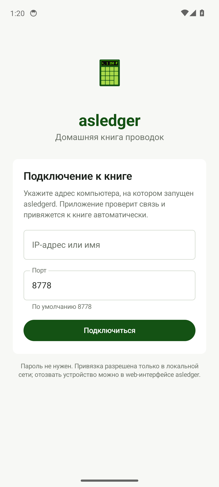 |
| Онбординг | 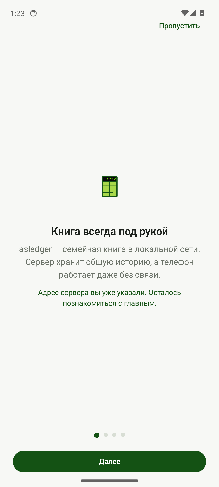 |
| Последний шаг онбординга | 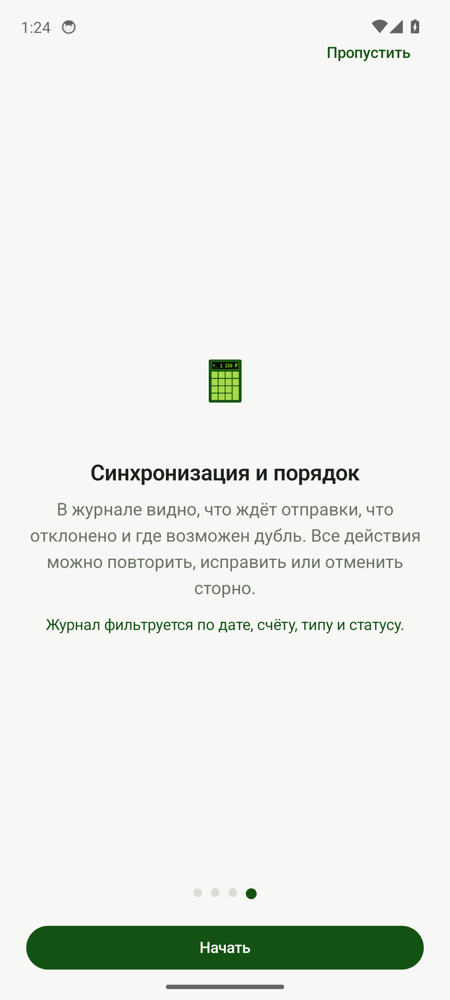 |
| Пустой журнал | 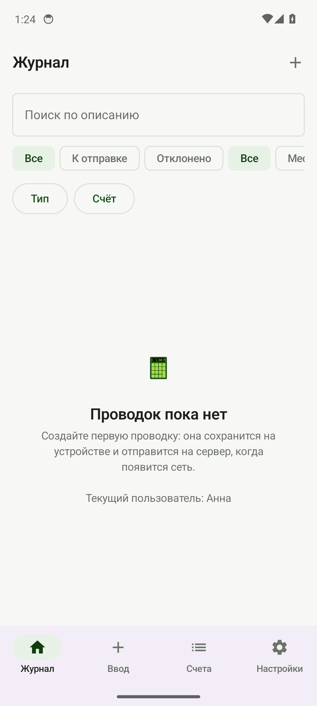 |
| Счета только для роли «расход» | 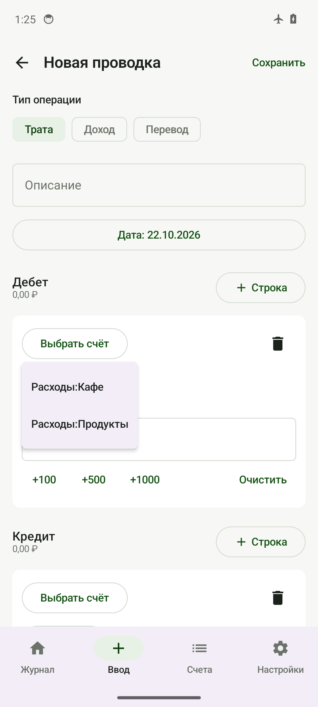 |
| Заполненная проводка | 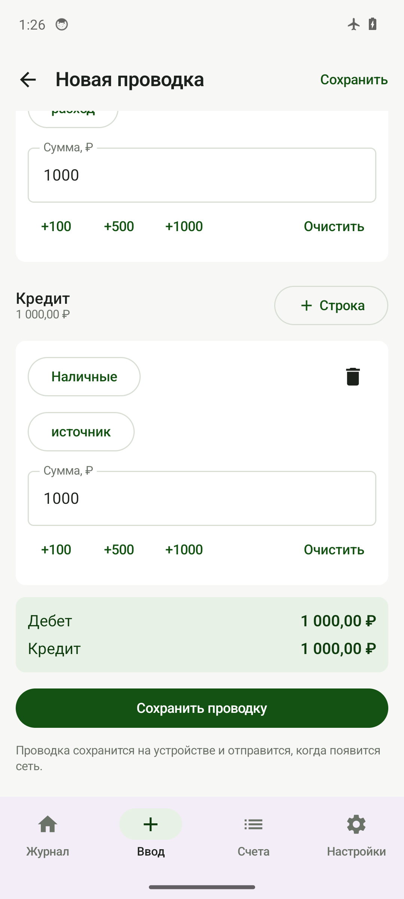 |
| Проводка в очереди | 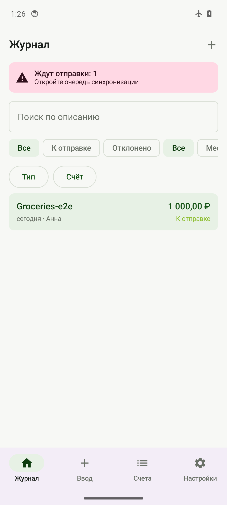 |
| Два клиента после pull | 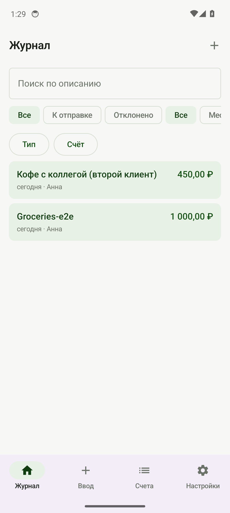 |
| Альбомная ориентация | 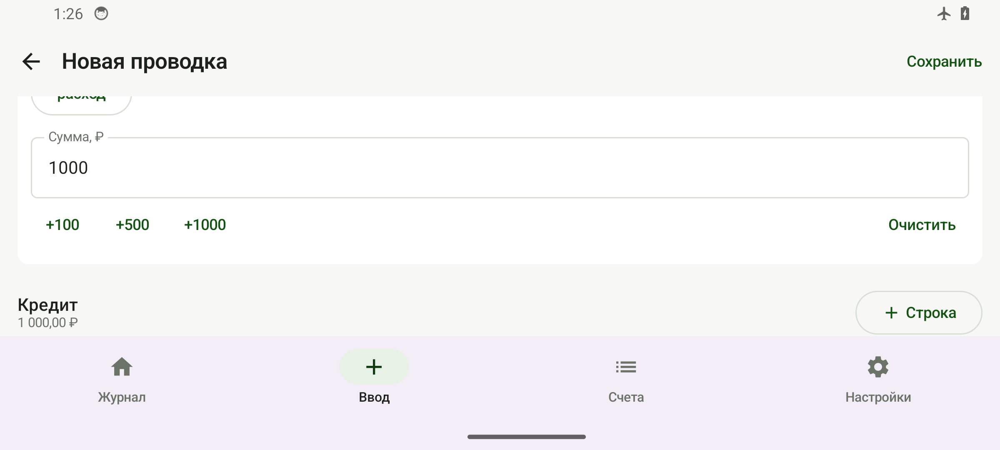 |
| Шрифт 200 %, журнал | 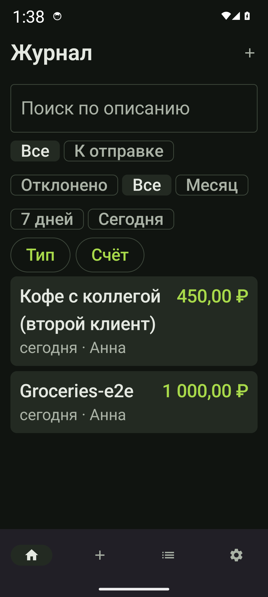 |
| Шрифт 200 %, форма | 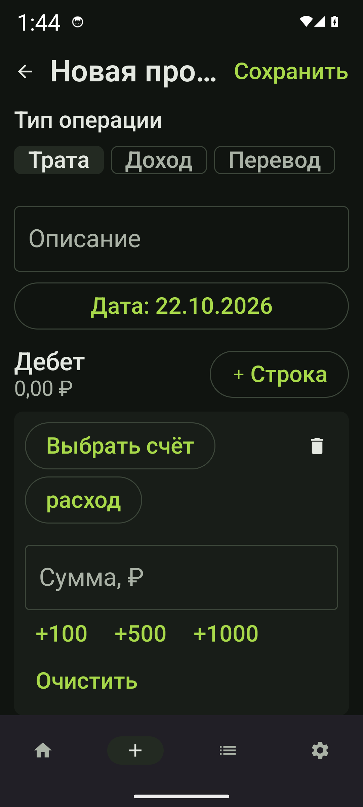 |
| Шрифт 200 %, онбординг | 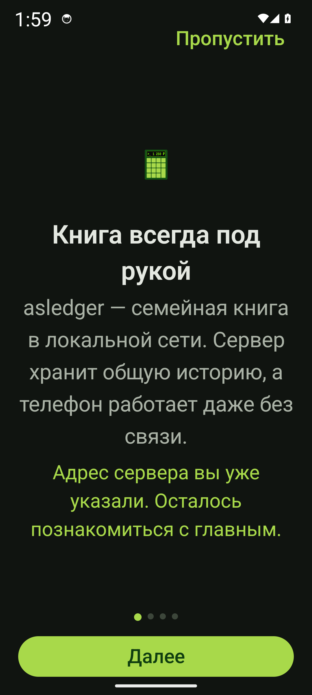 |
| Шрифт 200 %, счета | 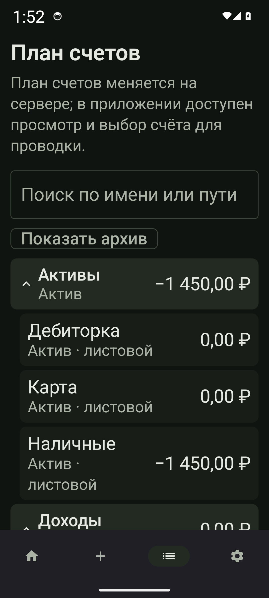 |
| Подсказка у роли | 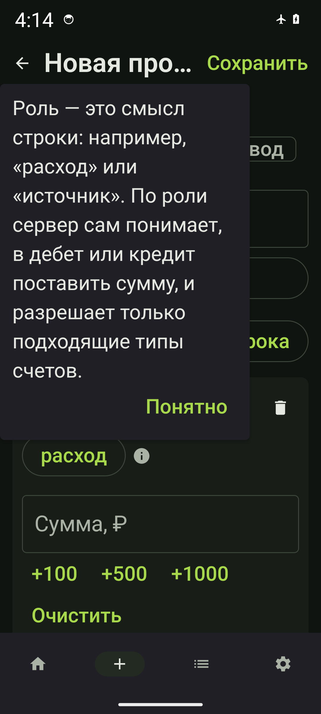 |

Ограничение среды: в CI нет эмулятора API 34, поэтому установка APK на
устройство и ручная проверка TalkBack/поворота выполняются при релизе вручную.
Автоматическая часть сценария (первый запуск, офлайн-проводка, push, pull вторым
клиентом, rejected, resync) покрыта интеграционным тестом.

## Известные ограничения

- Поддерживается `format_version = 1`; при другом формате приложение просит
  обновить `asledgerd`.
- План счетов на телефоне только для чтения; редактирование — в web.
- Отчёты, сверка, импорт hledger и мультивалютность в Android не входят.
- Контраст тем проверяется Unit-тестом по WCAG AA, восстановление состояния
  формы — Compose-тестом. Полный голосовой аудит TalkBack остаётся ручным:
  автоматизировать работу экранного диктора в CI нельзя.
- HTTPS/VPN не настроены: предполагается доверенная домашняя сеть.

## Вне рамок первой версии

iOS, Google Play, редактирование плана счетов с телефона, отчёты и сверка,
мультивалютность, push-уведомления, биометрия, несколько книг, HTTPS/VPN,
фоновый обмен в реальном времени.
